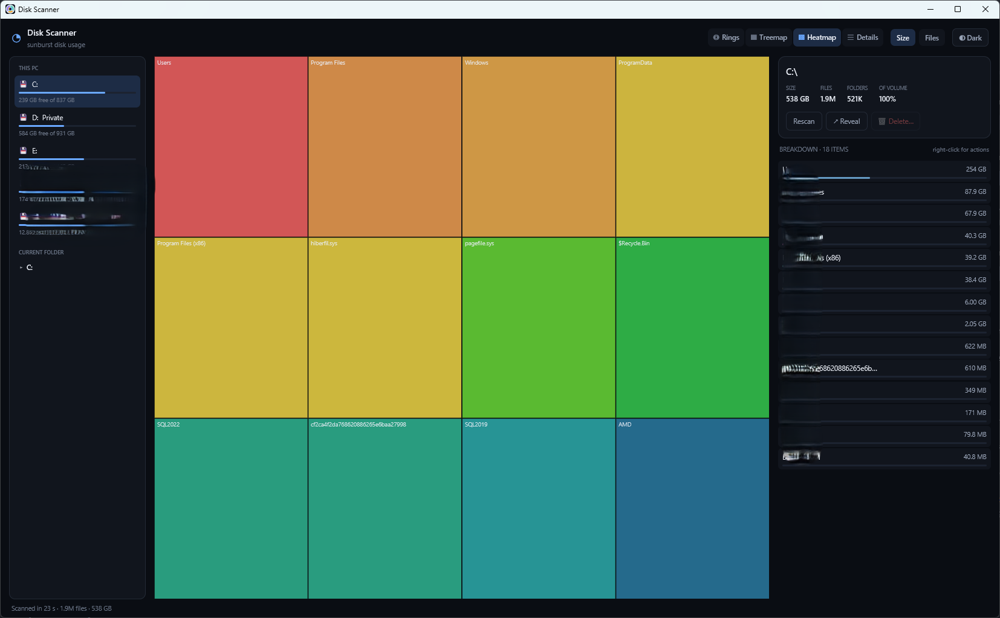

# Disk Scanner

[](https://github.com/spajce/disk-scanner/releases/latest)

A desktop disk-usage explorer that renders a whole volume three ways — a zoomable
**sunburst**, a cushion-shaded **treemap**, and a log-scaled **heatmap** — every folder
level at once, sized by bytes or by file count, in the spirit of the classic Scanner
(Steffen Gerlach, 2012) and WinDirStat/WizTree, but rebuilt as a native Rust app.


| Rings | Treemap | Heatmap |
| --- | --- | --- |
|  |  |  |

## Download

Grab the latest `disk-scanner-*-windows-x64.zip` from the
[releases page](https://github.com/spajce/disk-scanner/releases/latest), unpack it and run
`disk-scanner.exe`. There is no installer and nothing else to install; building from source
is described [below](#building).

## What it does

- **Scans a volume or folder in parallel** with a `rayon`-backed walker; one pass, no
  index file, cancellable at any time.
- **Three views of the same tree** (`1` / `2` / `3`, or the buttons in the top bar):
  - **Rings** — the multilevel sunburst: the hub is the current folder, each ring one
    directory level deeper. Click a slice to zoom in; hover to trace its ancestry.
  - **Treemap** — the WinDirStat/WizTree layout, squarified so cells stay close to square,
    with a cushion gradient that makes nested folders readable at a glance.
  - **Heatmap** — every item *in the open folder* gets an equal cell and the colour carries
    the size on a logarithmic scale, which is what makes "a thousand small files add up to
    more than the one big folder" visible; sorted-list and treemap layouts hide exactly that
    pattern. Clicking a cell opens it, so the grid refills with its contents.
- **Weights cells and rings by size or by file count** — the same tree, re-proportioned.
- **Breakdown panel** lists the biggest direct children of the focused folder, with a
  visual share meter, and syncs hover highlighting with the chart.
- **Clickable path** in the focus card: every folder name in `C:\Users\…\Xamarin` is a
  breadcrumb segment, so one click re-centres the chart on that folder (and on a folder
  outside the current scan it simply starts scanning it).
- **Right-click actions** on a slice, a treemap cell or a breakdown row: *Reveal in
  Explorer* opens the clicked folder itself (a file is selected inside its parent), and
  *Delete folder* / *Delete file* asks first with the native Windows confirmation dialog
  (No is the default answer) and then moves the item to the Recycle Bin. The menu is drawn
  on the chart itself, so it works in every view and never hands the click back to the chart
  underneath.
- **Live progress** while scanning (files, bytes, current path) plus per-volume free space
  in the top bar.
- **Focus card actions**: everything that acts on the open folder lives beside its name — the
  `↑ Up` button next to the clickable path, then *Rescan folder*, *↗ Reveal* and *🗑 Delete…*
  in one row. The top bar keeps only global controls (volume select, view, metric, theme).
- **Rescan what you are looking at**: inside a folder the *Rescan folder* button (or
  `F5` / `Ctrl+R`) re-walks just that subtree and pushes the size difference back through the
  ancestors instead of re-reading the whole volume; at the root the same button re-walks the
  volume.
- **Volume switching never rescans or blanks out**: the top bar holds a combo box — it names
  the open drive with its free/total space and a usage bar, and clicking it drops a card down
  over the chart with one detail row per volume (`C:`, `G:  Google Drive`, free of total, its
  own usage bar). The open row is marked; hovering lights a row. A volume already walked in
  this session is painted from memory the instant you pick it; only a volume you have never
  scanned starts a walk. Refreshing is always explicit (`F5` / `Ctrl+R` / *Rescan*).
- **Auto / Dark / Light theme**: the `◐` toggle follows the Windows app theme by default and
  remembers your choice in `%APPDATA%\disk-scanner\theme.txt`.
- **Keyboard**: `Backspace` / `↑` / `←` zoom out one ring (folded chain folders included),
  `1` / `2` / `3` switch views, `F5` / `Ctrl+R` rescan the open folder, `Esc` closes the
  menu, dialog or tooltip (or stops a running scan).

No webview: the window, the chart and the panels are drawn by GPUI directly.

## Stack

| Layer | Choice |
| --- | --- |
| UI | [GPUI](https://crates.io/crates/gpui) 0.2 — native Rust rendering, no HTML/CSS |
| Scanner | Rust — `windows-sys` for volume info and the shell, `rayon` for the parallel walk |
| Chart | hand-rolled arc, squarified-treemap and heatmap geometry (`PathBuilder` →
  `Window::paint_path`, `Window::paint_quad`), no plotting crate |

## Layout

```
apps/desktop-gpui/
  build.rs       embeds assets/icon.ico as the executable + window icon
  assets/        icon.ico / icon.png (drawn by scripts/make-icon.py), app.rc
  src/main.rs    entry point: opens the 1320x880 window
  src/app.rs     the view: top bar, chart area, breakdown panel, status bar, overlays,
                 scan job plumbing, zoom state, context menu + delete flow
  src/model.rs   tree model, ring/slice/tile layout, hit testing, geometry
  src/theme.rs   light + dark palettes, sunburst palette, heatmap ramp, formatters
  src/sys.rs     Explorer reveal + Recycle Bin (SHFileOperationW), Windows theme probe
crates/disk-scan/
  src/scanner.rs parallel directory walk, on-disk accounting, tree compaction
  src/drives.rs  Win32 volume enumeration (GetLogicalDrives, GetDiskFreeSpaceExW, …)
scripts/
  rust-env.ps1   runs cargo inside a working Visual Studio developer environment
  make-icon.py   regenerates the sunburst icon at every Windows icon size
```

### How the tree is made

The scanner accumulates sizes bottom-up in one parallel pass. Before it reaches the UI,
the tree is compacted so a 2-million-file volume still renders smoothly:

- children sorted by size; anything too small to draw on its own (`REL_FLOOR` /
  `ABS_FLOOR`) is *folded into the folder itself*, so no unnamed "(N more)" block ever
  hides the real folder names — only a folder with thousands of children (`WinSxS` and its
  like) still gets a single grey "smaller items" slice, because there is nothing better to
  draw with 15 000 cells;
- loose files below `FILE_FLOOR` are folded the same way;
- single-child chains are collapsed into `a/b/c` slices, and *Up* follows the rings rather
  than the raw path, so `app.asar.unpacked/dsh/node_modules` returns to `resources` even
  though the intermediate folders are not nodes of their own;
- the total node count is capped (`NODE_BUDGET`) and depth is bounded.

The UI never walks a raw directory tree — it only lays out what the scanner decided is
worth showing, and caps itself at `MAX_RINGS` rings and `MAX_SLICES` arcs per view. The node
budget is split between siblings *in proportion to their size*, so the detail follows the bytes
and a deep branch like `AppData\Local` keeps its own children instead of collapsing into one
bucket.

### How the numbers are accounted

The scan reports what the volume actually holds, not the sum of the sizes Explorer would show
in a *list*:

- **On-disk size, not logical size** — sparse, NTFS-compressed and cloud placeholder files are
  re-measured with `GetCompressedFileSizeW`, so a 40 GB sparse VHD that occupies 3 GB is
  counted as 3 GB, and an undownloaded OneDrive file counts as the little it stores locally.
  The extra call is only made for files carrying those attributes.
- **Hard links counted once** — a file with more than one name is identified by
  `(volume serial, file index)` through one handle and only the first name contributes bytes.
  To keep that off the hot path only files of 8 MiB or more are checked (`DEDUPE_FLOOR`),
  which is where a duplicate link actually distorts a chart.
- **Reparse points** (junctions, mount points, dedup stubs) are skipped entirely, so
  `Users\All Users -> ProgramData` and cloud-sync links cannot be counted twice.

Measured on `C:\` here: 3.3 M files · 532 K folders, and the top-level numbers now match what
Explorer's *Size on disk* adds up to instead of the larger logical total.

## Building

Requires Rust 1.85+, the MSVC toolchain and the Windows SDK.

```bash
cargo build --release          # target/release/disk-scanner.exe
cargo run                      # debug build, scans the last folder you opened
cargo test                     # scanner tests + Recycle Bin integration test
```

On a machine with several Visual Studio installs, run cargo inside a correctly configured
environment instead:

```powershell
scripts\rust-env.ps1 cargo build --release
```

The app remembers the last scanned root in `%APPDATA%\disk-scanner\last-root.txt` and
rescans it on start (falling back to the first fixed drive). Scans are cached per volume for the
session, so picking a drive you already walked repaints instantly; a never-seen drive starts a
walk that shows the cached chart under a progress pill.

### How fast the walk is

Directories are listed with a single `FindFirstFileW`/`FindNextFileW` pass that already
carries the file size and attributes, so no per-file `metadata` call is needed, and each
directory's subdirectories are handed to `rayon` once there are four or more of them (at
every depth, not only near the root). Measured on this 20-thread Windows 11 machine with a
warm cache, using `cargo run --release --example scan -- <path>`:

| Path | 1 thread | 20 threads |
| --- | --- | --- |
| `C:\` (3.25 M files, 532 K folders) | 21.8 s | 6.9 s |
| `C:\Users\<you>\AppData\Local` (760 K files) | 3.8 s | 1.1 s |

Parallelism stops paying off well before the core count: the walk is bound by directory
metadata latency on a single volume, not by CPU.

### Running on a machine with several Visual Studio installs

`rustc` and the `cc` crate both pick the *newest* Visual Studio install. If that install is
incomplete (a pre-release toolset without headers or `lib\x64`), a plain `cargo build`
fails with `LNK1104: cannot open file 'msvcrt.lib'`. `scripts/rust-env.ps1` finds the first
install whose MSVC toolset actually contains `include\excpt.h` + `lib\x64\msvcrt.lib`,
imports the environment from its `vcvars64.bat`, and then invokes cargo.

## Notes

- Symlinks and every other reparse point (junctions, mount points, dedup stubs) are
  skipped, so `Users\All Users -> ProgramData` cannot double-count a volume and junction
  loops cannot trap the walk.
- Paths longer than `MAX_PATH` are handled through the `\\?\` verbatim form internally.
- Files that vanish mid-scan (locked, deleted, permission denied) are counted as skipped
  errors instead of aborting the scan.
- Deletes go through `SHFileOperationW` with `FOF_ALLOWUNDO`, so they land in the Recycle
  Bin; drive roots are refused.
- The first prototype of this app was a Tauri + TypeScript build; it lives in git history
  at commit `bbb8283`. The native GPUI app replaced it.
