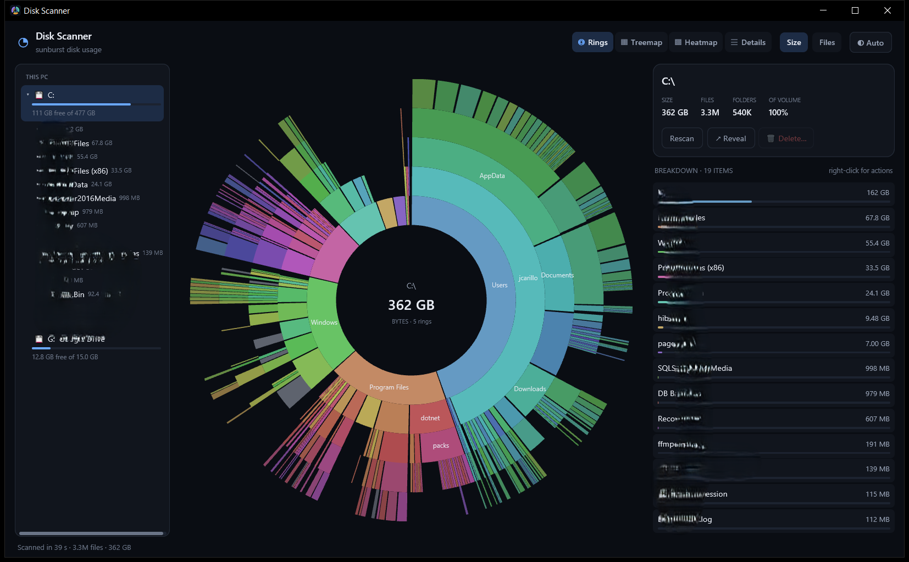
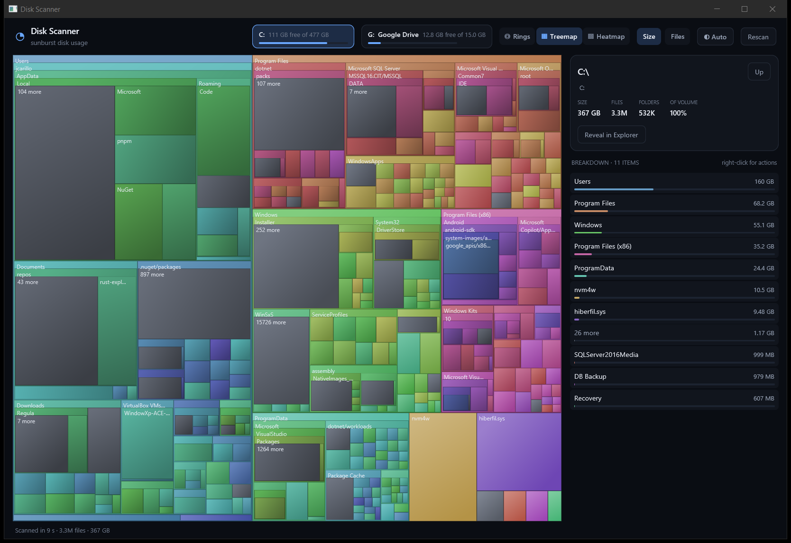
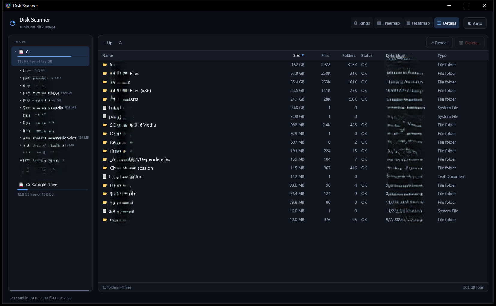

# Disk Scanner

[](https://github.com/spajce/disk-scanner/releases/latest)

A native desktop app that shows where the space on a drive went. It reads a volume or a
folder in one pass and draws the result four ways: a zoomable sunburst, a treemap, a heatmap
and a sortable details table. It runs on Windows, macOS and Linux.



| Sunburst | Treemap | Heatmap | Details |
| --- | --- | --- | --- |
|  |  |  |  |

## Download

Grab the latest `disk-scanner-*-windows-x64.zip` from the
[releases page](https://github.com/spajce/disk-scanner/releases/latest), unpack it and run
`disk-scanner.exe`. No installer, nothing else to install.

macOS and Linux build from source for now — see [Building](#building).

## What it does

- **One pass, cancellable.** A volume or a folder, stoppable at any time; *Stop* parks the
  walk with its counters and *Continue* resumes it.
- **Four views of the same tree** (`1` – `4`, or the buttons in the top bar):
  - **Rings** — a zoomable sunburst, one ring per folder level. Click a slice to open a
    folder; hover to trace its ancestry.
  - **Treemap** — nested rectangles sized by the space used, so the big items read at a
    glance.
  - **Heatmap** — one cell per item in the open folder, coloured by size on a log scale, so
    a thousand small files stand out as clearly as one big folder.
  - **Details** — a sortable table of the open folder: name, size, file and folder counts,
    status, date modified and type. Click a header to sort, double-click or `Enter` to open.
- **Navigation pane** — the volumes with their free and total space and a usage bar, then the
  chain of folders above the open one, so any drive or ancestor is one click away.
- **Size or file count** — the chart can be weighted either way; the details table shows
  both, so the toggle is hidden there.
- **Breakdown panel** — the biggest items in the open folder, colour-matched to the chart and
  highlighted in step with the pointer.
- **Act on what you find** — reveal an item in the file manager, or move it to the Recycle
  Bin after a confirmation. In the details view the same actions sit in the table's toolbar.
- **Live progress** — files, bytes and the folder being read, with a *Stop* button, in the
  card over the chart.
- **Light, dark, or follow the system** — the choice is remembered.
- **Keyboard** — `Backspace` / `↑` / `←` go up, `1` – `4` switch views, `Enter` opens the
  selected folder, `F5` or `Ctrl+R` rescans, `Esc` dismisses or pauses.

Everything is drawn by the app itself; there is no webview in the window.

## How it works

The walk is a single pass: each directory is listed with one call that already carries names,
sizes and attributes, and its subdirectories are handed to a work-stealing pool. Before
anything is drawn the tree is compacted — children sorted, items too small to draw folded into
their folder, single-child chains merged, depth and node count capped — so a volume with
millions of files still lays out smoothly.

Sizes are what the disk actually holds: compressed, sparse and cloud placeholder files are
measured by their allocated size, hard links are counted once, and symlinks and other reparse
points are skipped so nothing is counted twice.

## Layout

```
apps/desktop-gpui/src/app.rs     window, views, details table, panel, scan plumbing
apps/desktop-gpui/src/model.rs   tree model, chart geometry, hit testing
apps/desktop-gpui/src/theme.rs   palettes and number formatting
apps/desktop-gpui/src/sys.rs     shell integration, theme probe, file dates
crates/disk-scan/src/scanner.rs  parallel walk and tree compaction
crates/disk-scan/src/drives.rs   volume enumeration
scripts/rust-env.ps1             builds through a complete C++ toolchain
```

## Building

Requires Rust 1.85+ and a C/C++ toolchain:

- **Windows** — the MSVC toolchain and the Windows SDK.
- **macOS** — the Xcode command line tools.
- **Linux** — a C toolchain plus the development packages the window layer needs: X11 or
  Wayland, xkbcommon, fontconfig/freetype, and the GL/Vulkan drivers.

On Windows, run cargo through the environment wrapper. When several C++ toolchains are
installed it picks a complete one and then starts cargo; with a single, complete toolchain
plain `cargo` behaves the same. On macOS and Linux the wrapper is not needed.

```powershell
scripts\rust-env.ps1 cargo build --release   # target/release/disk-scanner.exe
scripts\rust-env.ps1 cargo run               # debug build, opens the last scanned folder
scripts\rust-env.ps1 cargo test
```

The app remembers the last scanned folder in `%APPDATA%\disk-scanner\last-root.txt` and
rescans it on start. A volume already walked in this session repaints instantly from memory.

For reference, a full `C:\` walk here (3.25 M files, 532 K folders) takes about 7 s with the
parallel walker and about 22 s single-threaded.

## Support

If this tool saves you time, you can support its development.

<!-- TODO: put the donation link here -->

*Donation link coming soon.*

## Notes

- Symlinks and every other reparse point are skipped, so nothing is counted twice and a
  junction loop cannot trap the walk.
- Paths longer than `MAX_PATH` are handled through the `\\?\` form on Windows; elsewhere the
  operating system has no such limit.
- Files that vanish or are locked mid-scan are counted as skipped instead of aborting.
- Deletes go wherever the desktop puts them — the Recycle Bin, the Trash, or the freedesktop
  trash — and volume roots are refused.
